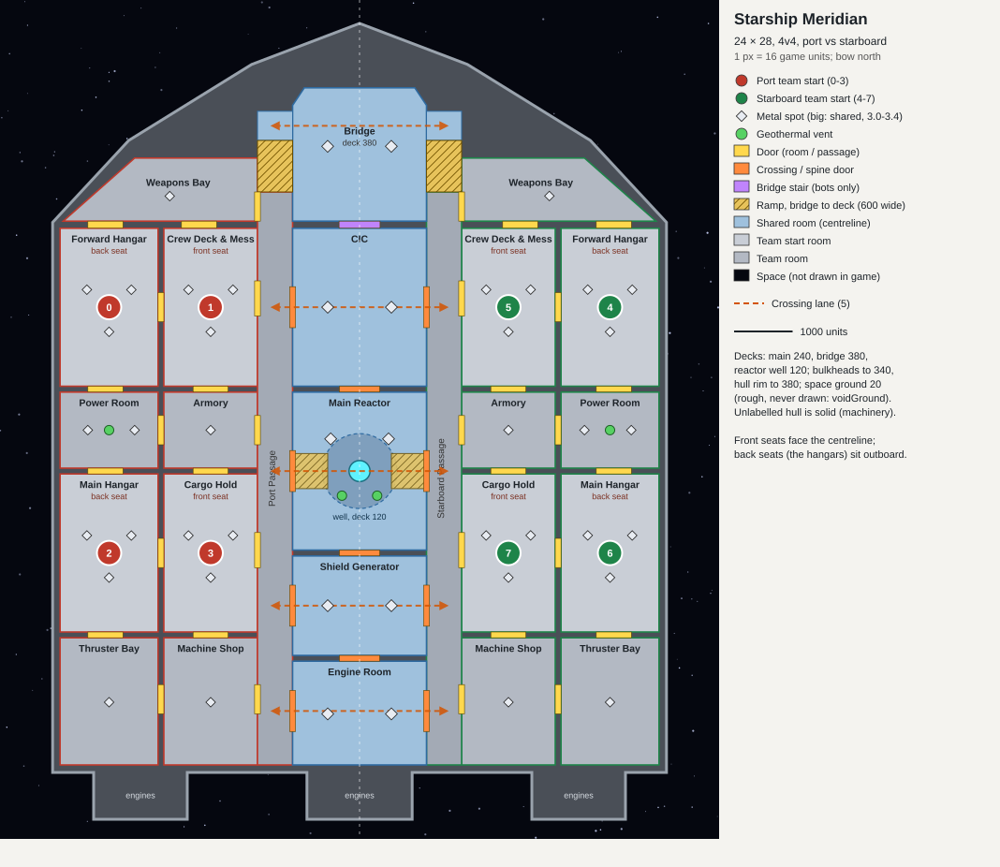

# Starship Meridian: design plan

A 4v4 map that is one whole starship. Two salvage fleets board a derelict battle-carrier adrift in space, one from the port side and one from starboard, and fight for the ship's centreline: the bridge, the command room, the reactor, the shield generator and the engine room.

**Status: built** to this plan, with no wind (your choice), as `starship_meridian_1.0.sd7`; see `CHECKLIST.md`. The layout's numbers live in one table, `design/layout.py`, which draws `design/layout.svg`; the same numbers are the converter's `Layout.cs`.

**As built, where it differs from the plan below:**
- **The reactor well's two ramps** run straight from the crossing doors down into the well (about 11°), not spiralling round its wall.
- **The solid hull's tops:** bulkheads 340, the rim and the engine housings 380, round the bridge 440.
- **Twins:** only the pallet is lopsided, so only it has a mirror-image twin (`sm_pallet_m`); every other model is its own mirror image.
- **Left out:** the landing beacons, the door frames and the stencilled deck numbers. The hangars' gantry cranes are service towers.
- **The archive** is 37 MB, not 110.

## Decisions for you

Each has a recommendation. The rest of the plan assumes it.

| | Recommended | The alternative |
|---|---|---|
| **Symmetry** | **Port against starboard**: a mirror image across the ship's centreline, the bow north. A ship is naturally symmetrical that way, the contested rooms sit on the centreline, and each team's half has the same rooms. | Bow against stern. That needs a double-ended ship or a half-turn symmetry, and loses the bridge-at-the-bow, engines-at-the-stern reading. |
| **Space round the hull** | **Void ground.** Space is ground at +20, above water level, that the engine never draws. The texture's alpha is 0 there, and with `voidGround` the engine cuts those pixels, so the skybox (a starfield) shows instead. There's no water anywhere, so no naval factories or floating defences can be built in space. The space ground is too rough to build on or walk, and the hull rim walls it off from every ground unit but spiders. | Hull to the map edges: no visible space except past the map's border. It's safe, but the ship's silhouette is lost. Avoid `voidWater`: it also hides the ground below 0, but the water is real, so air constructors could build ships and floating defences in space. |
| **Wind** | **0: no wind in space** (your choice). Wind generators are useless, so energy comes from solar, geothermal, fusion and the reclaim. Tidal is 0 too. | A normal 4-12, familiar to players. |
| **Size** | **24 × 28** (12288 × 14336), bow north. The hull takes 124 M of the map's 176 M square units. | 24 × 24 squashes the ship; 28 × 32 is large for 4v4. |
| **Name** | **Starship Meridian** | Any name you like (no franchise names). |

What I found to decide the space question:
- The engine's ground shader (`SMFFragProg.glsl`): `voidWater` cuts every fragment below water level. `voidGround` cuts wherever the map texture's alpha is below `voidAlphaMin` (0.9 by default), and it overrides `voidWater`. Both are `mapinfo.lua` settings (`MapInfo.cpp`).
- Our DXT1 tile encoder already writes punch-through alpha, so transparent texture pixels are possible.
- Our 3D renderer handles `voidWater` but not `voidGround` yet. It needs a small addition (draw the sky wherever the texture is transparent) so the pictures and the minimap match the game.

## The layout

The ship's long axis runs north to south, the bow at the top. The port half is west and the starboard half its mirror image east. Teams 0 to 3 are port, 4 to 7 starboard.

**Each team's half** is two columns of rooms on a main deck at height 240, beside its own **passage**, a 600-wide corridor the length of the ship.
- **Back seats** are outboard: the two hangars (air players, thematically).
- **Front seats** are inboard, facing the centreline: the crew deck and the cargo hold.

| Room (each side) | Size | Seat | In it |
|---|---|---|---|
| Weapons Bay (bow) | 2.9 M sq | | Gun mounts, munitions; 1 metal spot (2.4); doors to the forward hangar and the crew deck, and onto the level head of the passage beside the bridge ramp's foot |
| **Forward Hangar** | 1,670 × 2,700 | back (0, 4) | Parked fighters and a dropship, landing pads, a gantry crane; 3 spots round the start |
| **Crew Deck & Mess** | 1,600 × 2,700 | front (1, 5) | Mess tables, bunks, lockers, hydroponics planters; 3 spots |
| Power Room | 1,670 × 1,300 | | Capacitor banks, transformers; the team's **own geothermal vent**; 2 spots |
| Armory | 1,600 × 1,300 | | Weapon racks, munition crates; 1 spot |
| **Main Hangar** | 1,670 × 2,700 | back (2, 6) | Dropships, a cargo shuttle, tow tractors; 3 spots |
| **Cargo Hold** | 1,600 × 2,700 | front (3, 7) | Container stacks, cargo loaders; 3 spots |
| Thruster Bay (aft) | 1,670 × 2,170 | | Fuel tanks, the side engine's machinery; 1 spot |
| Machine Shop (aft) | 1,600 × 2,170 | | Repair gantry, benches, spare parts; 1 spot |

**The centreline** is shared and contested, 2,288 wide, from bow to stern:

| Room | Deck | In it |
|---|---|---|
| **Bridge** (bow) | **380**, raised | Consoles, the command chair, a forward viewport. 2 spots (3.0); high ground. On each side, a landing joins the bridge along 500, and a ramp 600 wide and 880 long (about 9°) runs straight down in line with that side's passage. A grand stair leads into the CIC, for bots only |
| **CIC** (command room) | 240 | A holo-table (glowing), console rings; 2 spots (3.0) |
| **Main Reactor** | 240, with a sunken **well at 120** | The reactor core (a glowing landmark) in a well 1,280 across. A ledge of 500 or more runs all round it at deck level, and the crossing doors open onto it. Two ramps, one from each crossing door, run straight down into the well. **2 geothermal vents** on the well floor, one each side of the core; 2 spots (3.4) on the ledge |
| **Shield Generator** | 240 | The shield emitter (a glowing landmark on pylons); 2 spots (3.0) |
| **Engine Room** (stern) | 240 | The drive core, coolant towers; 2 spots (3.0). Behind it, the central engine housing, its engine bells over space |

**Five crossing lanes** join the halves, each through a shared room: the bridge (by its two ramps), the CIC, the reactor (round its ledge, or down through the well), the shield generator and the engine room. Their doors from the passages are 700 wide. The shared rooms are also joined bow to stern by 688-wide spine doors, so a team holding one can push along the centreline.

**Each team's own routes:** doors between the two columns (500), fore and aft within each column (600), and from the inboard rooms to the passage (500-600). A back seat's army reaches the passage through its front teammate's room, or by the bow and stern rooms.

**Solid hull:** everything inside the hull that isn't a room, a passage or a ramp is solid at the rim's height (380). That covers the machinery spaces and the hull's structure: the bow forward of the bridge and the weapons bays, the stern between the engine housings, and the housings themselves.

**How close the fronts are:** the two teams' front starts are about 5,100 apart in a straight line, with one shared room between them (Red Dust's nearest were 8,988 apart by road). The first build's checks will log the driving distance through the doors. If it plays too close, move the front starts outboard within their rooms (up to about 800 further each).

## Decks, walls and doors

- **Heights:**
  - main deck 240;
  - bridge 380;
  - reactor well 120;
  - bulkhead tops 340, so walls stand 100 over the deck;
  - hull rim 380;
  - space ground about 20, rough.
  - Every floor is dead level for building.
- **Walls are terrain**, about 70° over 4 to 5 vertices. That is steeper than any vehicle (27°), hover (33°) or bot (54°) climbs, over the engine's 16-unit slope cells.
  - **Spiders** (all-terrain bots, 90°) climb every wall. That's intended: it's their flanking role. The checks log their route rather than forbid it.
  - The ground texture is projected straight down, so wall faces smear. They get plain bulkhead paint plus wall-face features (pipe runs, panels, door frames) for detail.
- **Door widths:**
  - nothing narrower than 500;
  - crossings 700, spine 688, passages 600.
  - The biggest ground unit's footprint is 112 wide.
  - Walls block direct fire, so a map of rooms can turn campy and artillery-heavy. Big rooms (start rooms 4.3 to 4.5 M square units) and wide doors are the counter.
  - If it still plays tight, the lever is to lower the team-side bulkheads to about 60, which still blocks movement but lets tall units shoot over, and keep the centreline's at 100.
- **Ramps**, all graded for vehicles: bridge to deck (about 9°), and the reactor well's two straight ramps from the crossing doors (about 11°).

## Economy

| | Per team | Shared (centreline) |
|---|---|---|
| Metal spots | 18: three round each start (2.0), weapons bay, power room ×2, armory, thruster bay, machine shop (2.4) | 10: two each in the bridge, CIC, shield and engine rooms (3.0), and the reactor (3.4) |
| Metal/s with a T1 extractor on each | 38.4 | 30.8 |
| Geothermal vents | 1, in its power room | 2, in the reactor well |
| Reclaim (machines, craft, crates) | About 3,000 metal, the same on both sides by the mirror | A little: crates and wrecked craft in the engine room and CIC |

Total: 46 spots (18 a team and 10 shared), 107.6 metal/s, 4 vents. `maxMetal` 4, as for the other maps.

## The features (all modelled and painted here)

**Key:**
- **L:** landmark (indestructible, uncrushable, no reclaim);
- **R:** reclaimable;
- **N:** doesn't block;
- **twin:** the model is lopsided, so the starboard copy is its mirror-image twin (`_m`). Everything else is placed with its heading mirrored (−h, in the engine's units).

| Where | Models |
|---|---|
| Hangars | dropship (R, twin), fighter (R), cargo shuttle (R), tow tractor (R), fuel cart (R), gantry crane (L), landing beacons (N) |
| Bridge, CIC | console bank (R), command chair (R), holo-table (L, glowing), viewport frame (L), sensor dome (L, on the hull) |
| Power, reactor, shield | reactor core (L, glowing), capacitor bank (R, energy), transformer (R), coolant pipe runs (N, on walls), shield emitter (L, glowing) |
| Engines | drive core (L), coolant tower (L), engine bells (L, over space), fuel tank (R, energy) |
| Crew deck | bunk rows (R), mess tables (R), lockers (R), med pods (R, glowing), hydroponics planters (R, green: the ship's one living colour) |
| Armory, cargo, shop | weapon racks (R), munition crates (R), missile cart (R), container stacks (R), cargo loader (R, twin), pallets (R), repair gantry (L), tool benches (R) |
| Hull, doors | point-defence turrets (L, on the rim), antenna masts (L), comm dishes (L), navigation lights (N: port red, starboard green), door frames (L, on the walls beside each door, never in it) |

That's about 35 models on one painted atlas.
- **Paint:** graphite and gunmetal plating, white panels, orange hazard trim, cyan light strips through the glow channel.
- **Side colour:** trim lights are red to port and green to starboard, a ship's navigation colours, so each side reads at a glance.
- **No franchise names or marks.**

## The look

- **Decks:** plating panels with seams and rivets, worn paint, oil stains and scorch marks, floor grates, and stencilled deck numbers.
  - **Hangars:** landing circles and guidance lines in the side's colour.
  - **Doors:** hazard stripes.
  - **The reactor well:** glowing rings.
- **Walls:** bulkhead plating, with pipes and panels as features.
- **Space:** the engine draws the skybox there, a starfield with a faint nebula, made by the converter.
- **The minimap and lobby picture:** the straight-down 3D render, with the starfield composited where the hull isn't.
  - The map is 24 × 28 and the minimap is always 1024 square, so the crop is explicit, from the camera's framing, and scaled unevenly. Cropping by the background's colour would fail against a starfield.
- **Light:** a nearby star's hard white light, deep shadows, low blue ambient, no fog.

## Checks (on the built map's own heights, round every blocking feature)

- **Symmetry:** the halves match exactly, heights and features (each feature's mirror image placed, its heading −h).
- **Reach:** every start, spot and vent is reached by vehicles and bots.
- **Crossings:**
  - each of the five crossings alone lets vehicles across;
  - with all five shut, no ground unit crosses but spiders, whose route is logged.
- **Space:** no ground class reaches space, amphibious and hover included. Space is too rough to build on (as built, 98% of it is too steep even for vehicles).
- **Doors:** every door is clear of features and at least 500 wide where it's narrowest.
- **Ramps:** graded for vehicles, the bridge's and the reactor well's.
- **Room to build:** every start room keeps at least 60% of its floor, about 2.6 M square units, level and free of features, in absolute terms; the mirror only makes the sides equal, not big enough. Metal spots are level and clear of features.
- **The fronts:** the driving distance between the front starts is logged (not a check), to decide whether to move them outboard.
- **Standing true:** every machine and building stands level.
- **Headings:** in the engine's units (65536 a turn). Getting this wrong was the bug that hit the four earlier maps.

## How it will be built (a gate after each phase)

1. **Layout and checks:** the converter (started from Red Dust Open Cut's, for its newer checks, with Starfall Marsh's mirror helper and ship atlas cells) builds the heights from `layout.py`'s table, with no models. *Gate:* all checks pass, and a straight-down relief render matches the drawing.
2. **The renderer:** add `voidGround` to MapTool's 3D renderer (the sky where the texture is transparent), with a test. *Gate:* a test map with a hole renders the hole.
3. **Models in the gallery:** every model on flat ground, their scale against BAR's units, and each twin against its original. *Gate:* you look at the renders.
4. **Placement:** props mirrored into every room, door frames, hull dressing. *Gate:* the checks, including doors clear and standing true.
5. **The look:** deck and wall paint, lights, the starfield skybox. *Gate:* renders.
6. **Minimap, lobby picture, notes,** then the release at your go-ahead.

## Risks

- **`voidGround` is new to these maps.**
  - A transport could drop units onto invisible space ground, where they'd stand stuck.
  - A spider could climb down off the rim into space.
  - Neither breaks a game, but both look odd. Worth trying in BAR first.
- **Interior fights** behave differently from open maps: walls stop direct fire. See the bulkhead-height lever above.
- **Archive size:** about 110 MB at 24 × 28 (as built, 37 MB). It's fine on a GitHub release, and it isn't committed.
