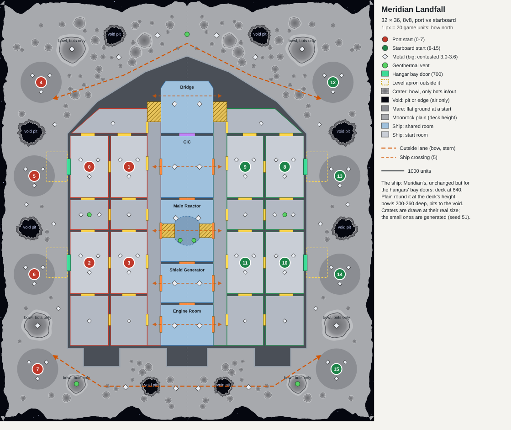

# Meridian Landfall: design plan

An 8v8 map. Starship Meridian, the same ship, has come down on an asteroid. The two fleets still fight port against starboard: inside the ship as before, and now outside on the asteroid as well. The moonrock round the ship is cratered, and here and there the rock has been blasted right through into void pits.

**Status: built** to this plan as recommended (invisible rubble on the void's floors, hangar bay doors, 32 × 36, no wind), as `meridian_landfall_1.0.sd7`; see `CHECKLIST.md`.

**As built, where it differs from the plan below:**
- **The edge** is shallower along the flanks (120 to 530) than at the bow and the stern (160 to 710), so the narrow flanks keep their room. The fore bowl, the aft bowl, the aft pit and the outside starts were moved clear of it, and the mares are 900 in radius, not 1,000.
- **The bowls** are 380 to 560 in radius; their walls hold 38° to 45°, the small craters' about 39°.
- **Small craters:** 62 a side, not 57, kept clear of the edge's slope.
- **The ship's walls** beside the bridge-level floors (above 280) stand at least 60 over them. Meridian's walls by its bridge ramps don't, which lets vehicles off the ramp onto the bow's hull top. Every other wall is Meridian's.
- **The pits' rims** are ridged, cracked rock, not plates, and their scarps fall in steps. Their outlines are fractal, not wedged. Each pit is a different rock with its own ore seams.
- **The edge** is a worn, gullied slope (about 23° on average) from a shoulder 360 to 480 inside its line, not a cliff. The pits, the aft bowls, six spots and the small craters near it were moved in to stay clear of it (reworked at your requests, to look natural).
- **Features:** no wrecked craft outside; the cargo at the aprons is the reclaim outside the ship (540 metal a side).

The numbers live in one table, `design/layout.py`, which draws `design/layout.svg` and writes `design/layout.json` for the converter. The ship isn't retyped: the table imports Meridian's own layout table (`../step50-starship-meridian/design/layout.py`) and moves it by one offset. The converter does the same with Meridian's `Layout.cs`, so the ship can't drift from the released one.

## Decisions for you

Each has a recommendation, and the rest of the plan assumes it.

| | Recommended | The alternatives |
|---|---|---|
| **Pits only air can cross** | **Invisible rubble on the void's floor.** The pits' floors (and the void at the asteroid's edge) are covered with indestructible, unreclaimable features that have no visible model. Their footprints block every ground unit, spiders included, and nothing can be built or unloaded there. Their collision boxes are buried deep under the floor, so they don't catch shots. | **Hidden deep water.** The pits' floors sink below sea level, and `voidWater` hides the water (checked in Recoil's source: with `voidWater` on, `HasVisibleWater` is false, so the water isn't drawn). Spiders stop at 20 deep. But air constructors could then build naval factories and floating defences in a pit. **Or accept spiders,** as on Meridian, where they climb every wall. Slope alone can't stop them: BAR's all-terrain bots (armspid, armsptk, armvang, corkarg) climb 90°. |
| **Ways into the ship** | **Bay doors in the hangars.** Each hangar's outboard wall gets a bay door 700 wide onto a level apron of moonrock. A team's outside players join their hangar teammates directly. The enemy can reach those hangars only by going round the bow or the stern and then through that team's flank. | **Doors in the weapons bay and thruster bay** instead, at the ship's ends. The start rooms stay closed, and the ways in sit nearer the outside lanes. **Or a sealed ship:** the outside is a separate battlefield, and no one goes between the two. |
| **Size** | **32 × 36** (16384 × 18432), with the ship centred and its bow 2,048 from the north edge. Each flank is 2,200 to 2,800 wide beside the hull. The lanes round the bow and the stern are 1,700 to 2,300 wide. There are 18.9 M square units per player, and the hull takes 124 M of the 302 M. | **36 × 38.** Flanks of 3,200 to 3,800 and lanes of 2,200 to 2,800, for a roomier outside. For scale: the 8v8 maps here (All That Glitters, Ascendancy, Crimson Bay, Folsom Dam) run 12 × 20 to 24 × 24. 32 × 36 is already about twice their area per player, though a third of it is the ship's walled interior. |

**Defaults, unless you want otherwise:**
- **Wind 0 and tide 0**, as on Meridian. There's no air on an asteroid.
- **The name:** Meridian Landfall.
- **The starts:** 16 of them. Positions 0 to 7 are all port's and 8 to 15 starboard's, so play with fixed starts splits the teams right.

## The layout

**The ship** is Meridian's, unchanged except for the bay doors. It is moved by (2048, 2048) and raised by 400, so its deck is at 640. Its eight start rooms, five crossing lanes, 46 metal spots and 4 vents all come with it.

**The asteroid** surrounds it. It is a moonrock plain at the deck's height (about 640, rolling gently, everywhere under 8° where it isn't a crater), so the bay doors open level onto it. The hull's sheer side rises 140 from the plain to the rim (780).

| Area (each side) | What's there |
|---|---|
| **The flank** | Between the hull's long side and the asteroid's edge. Two outside starts sit by the hangars' bay doors: **5** (1450, 7700) and **6** (1450, 12000). Their aprons are kept level and clear. A void pit lies between each pair of starts, and the flank's own metal is beside them |
| **The fore field** | North of the bow, where the hull narrows to its tip. Start **4** (1900, 3500) is out on its west side. There's a big bowl crater (bots only) with rich metal on its floor, a void pit, contested metal (3.0), and a geothermal vent on the centreline at the bow |
| **The aft field** | Behind the stern, round the engine housings, whose engines hang over the moonrock. Start **7** (2000, 16600) is here. There's a bowl crater with a vent on its floor, a small void pit, and contested metal (3.0) |
| **The asteroid's edge** | Ragged: the rock comes to between 160 and 760 from the map's border, in bays. Beyond it is void |

**Each outside start sits on a mare**, a flat dark lava plain 1,000 in radius. It is level for building, and craters keep at least 1,300 clear of its centre.

**Lanes:**
- **In the ship:** its five crossings, as on Meridian.
- **Outside:** two crossings, round the bow and round the stern.
- **Between the two:** each team's two bay doors join its outside players to its hangars.

## Craters and void pits

None of them has a ramp in or out. No crater outline is a circle. Every outline wavers, and the void's edges are broken into shards (`jag` in `layout.py`). Only the ship has straight edges.

| Kind | Size | Who gets in |
|---|---|---|
| **Small craters**, about 57 a side (generated, seed 51) | 70 to 300 across in radius, 20 to 85 deep, low rims | Bots only: their walls are about 40° |
| **Bowls**, 3 a side | 420 to 640 in radius, 200 to 260 deep, rims raised 80 to 110 | **Bots only.** The inside walls are held between 36° and 48° all round: steeper than vehicles (27°) and hovers (33°) climb, gentler than bots (54°). The floor holds rich metal (3.6) or a vent |
| **Void pits**, 4 a side | 380 to 560 in radius | **Nothing but aircraft.** The walls are over 60° and drop about 320 into the void. The engine doesn't draw the floor, so the starfield shows through the asteroid, and invisible rubble covers it (see the first decision) |

**Bots only means the bot band.** Amphibious tanks (armcroc, corseal, armbeaver) and armamph climb 54° too, so they get into the bowls as bots do.

**The void pits look blasted through:**
- **The outline** is broken by narrow wedges where rock was blown out, and by slabs left standing.
- **The rim** is uplifted and shattered into broken plates.
- **The void's cut** sits partway down the steep walls. The broken rock faces drop straight into stars, with no ledge at the bottom.
- **Fragments** of rock and shards lie strewn round each pit, and bright fresh-broken faces are painted on its walls. Ejecta rays streak out across the plain.

## Economy

| | Per team | Contested |
|---|---|---|
| In the ship | 38.4 metal/s (18 spots), 1 vent | 30.8 (10 spots), 2 vents |
| Outside | 33.6: three spots round each outside start (2.0), and four on the flank (2.4) | 38.4: eight in the fore and aft fields (3.0), and four on the bowls' floors (3.6, bots only) |
| Total | 72.0 metal/s of its own, 2 vents (the power room's, the aft bowl's) | 69.2, and 3 vents (the reactor's two, the bow's) |

That's 90 spots and 213.2 metal/s in all, about 13 a player. `maxMetal` is 4, as for the other maps.

## Features

- **Moonrock:** boulders in five sizes, flat slabs, and shards. They're heaviest round the void pits and the bowls' rims, and thin out on the plains. They're kept off the aprons, mares, spots and lanes.
- **The ship's landing:** landing struts with their footpads, three on each long side between the bay doors (they're cover). There are scorch marks from the landing burn round the hull.
- **At the bay doors:** cargo set down outside (containers, crates, a tug), using Meridian's models.
- **The void's rubble:** invisible, indestructible blockers, one per 256-unit cell of void floor.
- **Reclaim:** the cargo and a few loose craft. The rocks are landmarks, with nothing to reclaim.

## The look

- **Highlands:** pale grey regolith with fine speckle, and pockmarked with tiny craters (paint only).
- **Maria:** darker, smoother grey.
- **Fresh craters:** bright ejecta rays.
- **Bowls:** slumped walls, and darker floors.
- **Void pits:** dark fractured rock with bright broken faces, falling into the starfield.
- **Round the ship:** scorch from the landing, and tracks from the bay doors.
- **The sky and light:** the starfield sky, and Meridian's hard star light with black shadows.
- **The minimap and lobby picture:** the straight-down 3D render, as before. The crop is from the camera's projection, with the starfield wherever the void is.

## Checks (on the built map's own heights, round every blocking feature)

Meridian's checks all stay, moved with the ship. These are added:
- **Symmetry:** the halves match, the craters and pits included. Jagged edges are read at mirrored places, and centreline craters are centred on it.
- **Starts:** all 16 reached, each start and mare level, and each outside start room 60% free and level.
- **Outside starts:** each one reaches its own team's bay doors by vehicle.
- **The outside lanes:**
  - with the ship's five crossings shut, the bow lane alone lets vehicles across, and so does the stern lane alone;
  - with all seven shut, no ground unit crosses, spiders included.
- **The bowls:**
  - vehicles and hovers can't reach any bowl's floor;
  - bots get in and out of each one;
  - the walls stay between 36° and 48° on the engine's 16-unit slope cells.
- **The void:** no ground unit reaches it, spiders included. That covers the pits and the edge.
- **The hull:** no ground unit but spiders reaches any of the hull's solid tops from outside. Otherwise vehicles could drive along the bulkheads' tops.
- **No smooth edges:** every crater's and pit's outline differs from its best-fit circle by at least 6% of its radius.
- **Room to build:** the aprons, mares and spots are level and clear, and every feature stands level.
- **The fronts:** driving distances are logged, in the ship and outside.

## How it will be built (a gate after each phase)

1. **Layout and checks.** The converter is a copy of Meridian's: the ship is its `Layout` under one offset, and the asteroid's heights come from this table's craters. *Gate:* all checks pass, and a straight-down relief render matches the drawing.
2. **The void.** The pits and the edge get transparent texture and their blockers. *Gate:* the void checks pass, and renders show the stars through the pits.
3. **Features.** Moonrock, the landing struts, the cargo. *Gate:* renders.
4. **The look.** The regolith, maria, ejecta, scorch and the pits' broken faces. *Gate:* renders.
5. **The minimap, the lobby picture and the notes,** then the release at your go-ahead.

## Risks

- **The invisible rubble is new.**
  - Does BAR leave buried collision boxes alone, or do shots or the D-gun react to them?
  - How does the pathfinder treat a few thousand blocked cells?
  - Both are worth a test game.
- **Size:**
  - The texture is 16384 × 18432 (302 M texels): bigger than Meridian's, but well within memory here (32 GB).
  - The archive should be about 70 to 90 MB.
  - 8v8 on a map this size is slow to cross. The ship's walls cut lines of sight, and the outside lanes are about 2,000 wide.
- **The flanks are narrow** (2,200 to 2,800). If the outside plays cramped, 36 × 38 is the lever.
