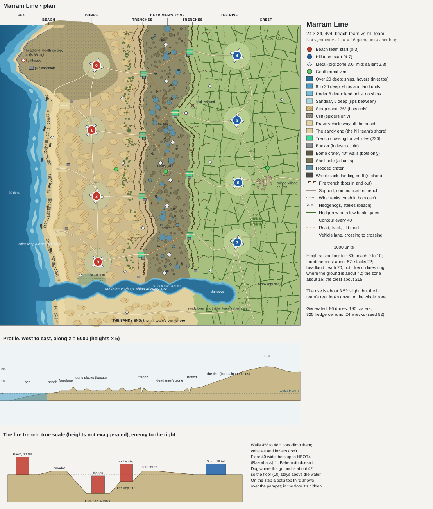

# Marram Line: design plan

A 4v4 map on a coast where an old war dug in and never left. From the sea in the west it runs: the sea, a wide beach with its old obstacles, a foredune cut by draws, a belt of dunes, the beach team's trenches, the dead man's zone, the hill team's trenches, and then a slight rise to a crest of fields and hedgerows. The two trench lines face each other across the zone. The landscape isn't symmetric and isn't meant to look made: a rocky headland juts into the sea in the north. In the south a tidal inlet runs in from the sea, through both trench lines and the zone, to a sandy cove at the hill's foot. Both teams take to the water, and ships sail up into the battle.

**Status: built 2026-10-25, with every recommendation below; not released yet.** The built map, its checks, and where it differs from this plan are in `CHECKLIST.md`. The plan below is kept as it was written.

The numbers live in one table, `design/layout.py`. It draws `design/layout.svg` (the plan to scale, a west-to-east profile, and the fire trench's section at true scale) and writes `design/layout.json` for the converter. The dunes, craters, hedgerows, wire and wrecks are generated from a fixed seed (52), so the drawing shows them where they'll be built.

## Decisions for you

Each has a recommendation, and the rest of the plan assumes it.

| | Recommended | The alternatives |
|---|---|---|
| **Who holds what** | **Beach team against hill team.** The beach team's bases are in the dunes with the sea at its back. The hill team's are on the rise with the crest at its back. Each holds its own trench line, facing the other across the zone. The map isn't symmetric, so its fairness is measured on the built map, as on Red Dust Open Cut. | **A landing, D-Day style:** one team starts on the beach and has to break out against a hill that's already dug in. BAR gives both teams a base from the first minute, so a map can't force the landing; it would only mean giving the hill team much more ground and metal. Not recommended. **The coast along a flank:** the sea runs down one side of the map, and each team gets some beach, dunes and sea. Closer to fair, but less like the picture you described. |
| **Size and players** | **4v4 on 24 × 24** (12288 × 12288). 18.9 M square units a player. Each start is 2,784 to 2,840 from the zone's middle in a straight line. Each side has four vehicle crossings, one for each player's front. | **3v3 on 20 × 20:** three starts and three crossings a side, the zone about 1,700 across. **2v2 on 16 × 16:** two crossings a side, the zone about 1,400, fewer dunes and fields. **8v8 on 32 × 28:** the front 32 long, eight crossings a side. |
| **The trenches** | **Bots in, vehicles across at gaps.** The fire trench's floor is 32 down and 40 wide, with a fire step at 12 down and a parapet 6 over the ground. Its walls are 45° to 48°, so bots climb in and out anywhere and vehicles and hovers never do. Each line has four crossings, 220 wide, each covered by a bunker, and ends in the south at the inlet's bank. The crossings are staggered against the other side's, so the lanes run at a slant. | **Shallow trenches** (16 down, walls under 27°): every class drives in and out, slowly. No chokepoints, and a more open tank war. **An anti-tank ditch** in front of each line instead of crossings: vehicles cross only by two causeways a side. |
| **Wire, hedgerows, beach obstacles** | **They shape movement, and tanks break through.** Two broken belts of wire lie in front of each fire trench. T1 tanks and anything heavier crush it; bots, scouts and hovers can't. So tanks open lanes for the bots, as they did in the war. Constructors can also reclaim it. Hedgerows grow on low banks every class can cross. Their bushes crush like the wire; the trees in them are crushed only by heavy tanks. There's a gate every 700 or so. The beach's steel hedgehogs block every ground unit but the heaviest, and are worth a little metal reclaimed. The bunkers are indestructible. | **All of it decoration:** nothing blocks, and only the ground shapes the fight. **Indestructible wire:** it can't be reclaimed or crushed. A hard maze; not recommended. |
| **The sea and the inlet** | **Ships in the sea and all the way up the inlet.** The sea is 60 deep offshore. Broken sandbars 400 out, 5 deep, keep ships off the west beach except through the rips between them. From behind the bars a destroyer (Corsair, range 700) or a battleship (Dreadnought, 880) reaches the beach but not the dunes. The inlet is 24 to 32 deep along its whole middle, from the sea to the cove. Every ship gets up it, battleships included, and no land unit crosses it. Ships in it fight at the zone's south end, under both lines' guns. | **A ford in the zone,** 16 deep: land units wade across, and every ship still passes. The sandy end then opens to the beach team too. **A shallow inlet** (under 8 in the zone): ships only as far as the beach team's line; hovers beyond. **No ships at all:** the sea and the inlet under 8 deep. |
| **The hill team's sea** | **Both a cove and a shore.** The inlet ends in a sandy cove 700 to 900 across, behind the hill team's line at the hill's foot: deep water ringed by sandy beaches, its sheltered shipyards. South of the inlet, the sandy end runs from the cove to the open sea: the hill team's own stretch of coast. Only the hill reaches it by land, round the cove. | **The cove only:** the inlet runs along the map's south edge, with no shore south of it. **The sandy end only:** the inlet ends in the zone, and the hill team's ships start from the open shore. |

**Defaults, unless you want otherwise:**
- **The name:** Marram Line. Marram is the grass that holds the dunes together, and the line is the trench line.
- **Wind 6 to 18, tidal 18.** A windy coast, and both teams now have water for tidal generators. Both numbers are first guesses, to be tried in a game.
- **The starts:** 0 to 3 are the beach team's (0 on the headland), 4 to 7 the hill team's. Play with fixed starts splits the teams right.
- **Sea in the west, north up.** The minimap and lobby picture are the straight-down 3D render, as before.
- **No national markings** on any wreck, bunker or building. It's a generic old war, as BAR's world would find it.
- **Shared assets:** the detail textures and the featureplacer gadget from All That Simmers, as the last maps used. The water settings would come from Crimson Bay, the coastal map here, if a render of its shallows looks right; otherwise they're tuned here. Every model is made here.

## Facts this plan rests on

Read from BAR's own files at commit 9d7bdf3 (the commit the editor's unit list uses), `gamedata/movedefs.lua` and the units' files:

| | |
|---|---|
| **Climbing** | Vehicles climb 27°, hovers 33°, bots 54°. Spiders and all-terrain bots climb any slope. |
| **Water depth** | Land units go into water up to 20 deep. Ships' movement classes need 8 (`DEPTH.MIN_SHALLOW`), and subs and the largest ships 15. Some ships' own files ask for more: the destroyer 12, the battleship 15. |
| **Unit heights** (collision boxes) | Pawn 30, Mace 30, Thug 32, Rocketeer 28, Stout 18, Brute 24, Shellshocker 24. |
| **Ranges** | Pawn 180, Mace and Thug 380, Rocketeer 475, Stout and Brute 350, Shellshocker (T1 artillery) 710. Sentry (the light laser tower, LLT) 430, Overwatch (the heavy laser tower, HLT) 620, Gauntlet (the plasma battery) 1,220. Corsair (destroyer) 700, Dreadnought (battleship) 880. |
| **Crush strength** | Light bots 15, bots 25, hovers 25, scout vehicles 18, T1 tanks 30, medium tanks 250, heavy bots and heavy tanks 252, commanders 50. |
| **Footprints** | Bots are 2 to 4 squares (16 to 32), up to Razorback (HBOT4). Behemoth is 7 (56). |

## The layout

**From west to east, at the map's middle:**

| Band | Width | Height | What's there |
|---|---|---|---|
| **The sea** | 1,700 to 2,100 | 0 down to −60 | Deep water offshore, the sandbars at 400 out with rips between, and shallows near the beach. Ships stay out past the bars, except at the inlet's mouth. |
| **The beach** | 430 to 580 | 0 to 10 | Wet sand at the water, dry sand above it, and a wrack line. Two broken rows of steel hedgehogs and stakes run along it, with 8 landing craft wrecked on it or in the shallows. One metal spot. |
| **The foredune** | 310 to 450 | crest 37 to 67 | Its seaward face is steep sand, 36°, which only bots climb. Three draws cut through it, each 260 wide at under 6°: the vehicles' ways off the beach, each covered by a bunker. |
| **The dune belt** | about 2,600 | slacks 22, dunes 15 to 47 over them | 70 parabolic dunes, 350 to 960 long, their steep landward slip faces bots-only. Flat damp slacks between them hold three of the beach team's bases. Pines grow on the back dunes. |
| **The beach team's trenches** | about 450 | dug where the ground is about 42 | The fire trench, the support trench 240 behind it, and communication trenches back into the dunes, all dug into the dunes' last ridge. The wire is in front. Its salient bulges east round a dune tongue at z 8,300. |
| **The dead man's zone** | 1,400 to 2,200 between the fire trenches (1,960 on average) | about 16 | A low meadow, shelled to ruin. It has 190 craters: 34 deep bomb craters (40° walls, bots only) and the rest shell holes every class crosses. 55 of them hold water. There are 16 wrecked tanks, cratered old roads and a ruined farm with the zone's vent in its yard. The inlet runs along its south end. |
| **The hill team's trenches** | about 450 | dug where the ground is about 42 | The same trenches, at the hill's foot. Its salient bulges west round a knoll (34 high, a windmill on it) at z 3,600. |
| **The rise** | about 3,000 | 42 up to the crest's 215 | About 3.2° on average: a slight rise, but from it the hill team's rear looks down on the whole zone. Fields with hedgerows, 0.15 to 0.8 M square units each, on banks with gates. Four bases are here. An orchard and a ruined village with its church stand on the crest, with the hill team's vent. |
| **The back slope** | about 1,300 | 215 down to 175 | More fields, and a metal spot. |

**North to south, what breaks the pattern:**
- **The headland** (north). It juts 1,180 into the sea. Its cliffs are 66 high, which only spiders climb, with shingle under them. A lighthouse and an old coastal gun casemate stand on the point. On top is heath at 70, where start 0 sits. A cut road climbs from the beach onto it at 9°.
- **The salients.** Each line bulges toward the other once: the beach team's at z 8,300, the hill team's at z 3,600, on opposite flanks. The zone narrows to 1,415 and 1,555 there. Each salient holds a 2.8 spot just behind its tip, worth holding and worth taking.
- **The inlet** (south). A tidal river 7,400 long, from the coast at z 10,950 to the cove. It meanders, between banks of sand and mud that rise at 12° from the water.
  - **The mouth:** 680 to 790 wide and 32 deep, with no bars across it.
  - **Through the dunes:** 490 to 670 wide, with salt marsh on its north bank.
  - **Through the zone:** 430 to 480 wide. It cuts the beach team's line at z 10,840 and the hill team's at z 10,620. Each line ends at the north bank, with a bunker on the bank covering the water.
  - **Its depth:** 26 in its channel, shelving to its banks over the outer 40% of its width. Every ship class gets up it, and no land unit crosses it: there's no ford anywhere. Hovers and amphibious units can use it to get behind either line.
- **The cove** (south-east). The inlet's end, 700 to 900 across and 24 deep, behind the hill team's line at the hill's foot. It is the hill team's harbour, with sandy beaches all round for its shipyards. Start 7 is 870 from its water. A dry brook bed comes down the rise into its head; the rise itself holds no water, since all water stands at 0.
- **The sandy end** (south). The shore south of the inlet, from the cove west to the open sea: sand flats at about 10, 16 low dunes, a beach and broken rows of hedgehogs. The hill team reaches it by land round the cove's south side; nobody else can, except across the water. It is the hill team's own stretch of open coast, with one of its metal spots.

## The trenches

The section is drawn at true scale under the plan.

- **Fire trench.** Its trace is crenellated: fire bays 88 long, alternately forward and back of the line, joined by traverses.
  - The floor is 32 below the ground and 40 wide: bots up to Razorback fit, Behemoth doesn't.
  - A fire step 20 wide at 12 down on the enemy side. A T1 bot on it shows its top third over the parapet. In the floor it's hidden.
  - The parapet (sandbags on spoil) is 6 over the ground, with a parados 6 high behind.
  - The walls are 45° to 48°: bots climb in and out anywhere; vehicles and hovers can't.
- **Support trench:** 240 behind, the same depth, no fire step.
- **Communication trenches:** zigzags back from the support trench toward the bases every 760 or so.
- **Machine-gun nests:** sandbag rings in the fire trench every 900.
- **Dry floors.** Both lines are dug where the ground is about 42, so their floors are at about 10, above the water. A flooded trench would be a road for hovers.
- **Crossings:** four a side, 220 wide, where the trenches end at sandbagged heads and a track runs through. The wire has lanes through it there.
  - The beach team's crossings are at z 2,000, 4,500, 7,000 and 9,400; the hill team's at 1,100, 3,600, 6,100 and 8,600.
  - Each is covered by an indestructible concrete bunker beside it.
  - In the south each line ends at the inlet's north bank, a bunker on the bank.
- **Wire:** two broken belts, 150 and 260 in front of each fire trench, down to the inlet's bank: 28,000 units of it in all.

**Why the zone is this wide.** An HLT (Overwatch, 620) in one line can't reach the other line's wire anywhere, not even at the salients. A Gauntlet plasma battery (1,220) dug in at a fire trench covers about 60% of the zone on average, and reaches the enemy's outer wire only where the zone is narrowest, round the knoll's salient. T1 artillery (710) from behind the wire shells the middle. So nobody holds the zone from home; it has to be crossed.

## Economy

| | Beach team | Hill team | The zone |
|---|---|---|---|
| At the starts | 16 spots, 2.0 each: 32.0 | 16 spots, 2.0 each: 32.0 | |
| Its own ground | 5 at 2.4: three in the dunes behind the line, one on the beach, one by the inlet's mouth | 5 at 2.4: three on the rise behind the line, one on the back slope, one on the sandy end | |
| The salient | 1 at 2.8 | 1 at 2.8 | |
| **Metal** | **46.8 metal/s** | **46.8 metal/s** | **8 spots at 3.0: 24.0** |
| Free energy | Tidal (18), a vent in a slack (an old gas well), wind | Tidal in the cove and off the sandy end, a vent at the village, wind | One vent, at the ruined farm |
| Reclaim | Landing craft, the beach's hedgehogs | The village's rubble | 16 wrecked tanks |

That's 52 spots and 117.6 metal/s in all, about 14.7 a player. `maxMetal` is 4, as for the other maps.

## Fairness (not symmetric)

What each side has that the other doesn't:

| Beach team | Hill team |
|---|---|
| The open sea all along its back, and the inlet's mouth | The height: the rise looks down on the zone, and its artillery fires downhill |
| | The cove, a sheltered harbour, and the sandy end, its own open shore |
| Flat slacks between dunes, and dunes that break up sight lines | Open fields with hedgerows, which give cover and slow vehicles |
| Its salient in the south | Its salient in the north, on a knoll |
| The draws: its vehicles reach the beach by three gaps | The village and orchard on the crest |

**Measured in the table now:** each team's own metal (46.8 each); each start's straight-line distance to the zone's middle (2,784 to 2,840); the ground in million square units (the beach team 41.6; the hill team 50.7, plus the sandy end's 7.5; the zone 25.2; the sea 21.4; the inlet 4.6); four crossings a side.

**Measured on the built map, as checks:**
- each start's driving distance to the zone's middle and to its nearest crossing, within 5% of its opposite number's (0 against 4, 1 against 5, and so on);
- level ground round each start, matched;
- reclaim a side, within 10%;
- each side's vehicle crossings.

## Features (all modelled here)

- **The beach:** Czech hedgehogs (steel), wooden stakes, wrecked landing craft (ramps down, some on their sides), driftwood, the wrack line's weed.
- **The defences:** concrete bunkers with gun slits at the draws and crossings, the coastal gun casemate, Tobruk pits, sandbag machine-gun nests, dugout entrances, revetted trench walls, duckboards, wire on its pickets.
- **The zone:** wrecked tanks (generic, no markings), shattered tree stumps, the ruined farm (broken walls, a barn without a roof), telegraph poles leaning at angles.
- **The hill:** hedgerow bushes and trees, the ruined village (stone houses, the church with its tower broken off), the orchard, the windmill on the knoll, hay ricks, field gates.
- **The coast:** the lighthouse, marram grass and sea holly on the dunes (they don't block), pines on the back dunes, reeds and salt marsh along the inlet.
- **The inlet and the cove:** a timber jetty and boat sheds in the cove, mooring posts, a wrecked landing craft aground at the mouth, channel markers.

## The look

- **Sea:** clear over sand, from turquoise in the shallows to deep blue, with surf lines on the bars.
- **The inlet:** sand and mud banks with reeds, a darker channel down its middle, pale sandy beaches round the cove.
- **Beach:** wet sand darker below the tide line, ripples, the wrack line, dry pale sand above it.
- **Dunes:** pale wind-sorted sand on the crests and slip faces, marram tussocks, blowouts, damp green slacks.
- **The headland:** purple-brown heather, grey rock on the cliffs, shingle below.
- **Trenches:** spoil and sandbags along the parapets, timber revetments, duckboards on the floors.
- **The zone:** churned brown mud and grey water in the craters, wire, blasted grass, scorch.
- **The hill:** a patchwork of fields (grazed green, hay, ploughed), dark hedgerows, sunken lanes, the village's stone.
- **Sky:** a bright coastal sky with high cloud; the sun from the south-west, so the dunes' slip faces and the hedgerows cast shadows.

## Checks (on the built map's own heights, round every blocking feature)

- **The trenches:**
  - bots get into and out of every fire and support trench;
  - vehicles and hovers get into none;
  - with all of a line's crossings shut, no vehicle crosses that line, bots do, and hovers only by the inlet;
  - each crossing alone lets vehicles across its line;
  - no trench floor is under water.
- **The beach:** each draw alone takes vehicles from the beach into the dunes, and so does the headland road. With all of them shut, vehicles stay on the beach, and bots still climb the foredune.
- **The craters:** bomb craters are bots-only; shell holes let every class in and out.
- **The water:**
  - no ship crosses a bar except through a rip;
  - every ship class (needing up to 15 deep) sails from the open sea up the inlet into the cove, and back out;
  - no land unit but amphibious ones crosses the inlet anywhere;
  - the sandy end is reached by land only from the hill team's side;
  - the cove's beaches have room for shipyards.
- **The headland:** its cliffs stop all but spiders.
- **Reach:** every start reaches every spot of its own and the zone's.
- **Fairness:** the measures above.
- **Room to build:** the starts' ground and every spot are level and clear, and every feature stands level.
- **Nothing straight:** no coast, dune, crater or field outline is a straight run or a circle (as step 51's check).

## How it will be built (a gate after each phase)

1. **Engine facts first,** in Recoil's source, as step 51 did:
   - that units crush features whose crush resistance is below their crush strength, and how BAR sets its trees';
   - that a parapet blocks a direct-fire weapon's line of fire as drawn;
   - that BAR's footprint clearance leaves indestructible features alone.

   *Gate:* each fact recorded with its file.
2. **Terrain and checks.** A new converter, grown from Red Dust Open Cut's, builds the heights from this table: the sea and its bars, the beach, the foredune and its draws, the dunes, the headland, the trenches, the craters, the inlet and its cove, the sandy end, the rise, the banks and the knoll. *Gate:* the access checks and the fairness measures pass, and a straight-down relief render matches the drawing.
3. **Features.** The models and their placing. *Gate:* renders, reclaim matched.
4. **The look.** *Gate:* renders.
5. **The minimap, lobby picture and notes,** then the release at your go-ahead.

## Risks

- **The imbalance is built in.** The beach team's open sea against the hill team's height, cove and sandy end is a guess until it's played. The levers, if one side wins too often:
  - the tidal value;
  - each side's vent;
  - the sandy end's size, or a ford that opens it to the beach team;
  - the bars' depth;
  - how high the crest is.
- **The trench walls may come out gentler than drawn.** The walls toward the enemy are about 18 across, about one of the engine's 16-unit slope cells. The engine blends a cell's steepest part toward its average. So a cell that's half wall and half floor or step can measure under 33°, or even under 27°, where the trench runs at an angle to the grid. The access check decides. If vehicles or hovers get in, those faces get wider.
- **Trench cover is a theory.** Whether bots on the fire step fire over the parapet, and are hidden in the floor, depends on the engine's line-of-fire test. Phase 1 checks it in the source, but only a game proves it.
- **Crushable wire and hedges** depend on an engine fact still to confirm. If the engine doesn't crush features, the wire becomes reclaim-only, and the gaps in it matter more.
- **Feature count:** about 3,000 hedge bushes and trees, and 1,000 lengths of wire, on top of the dunes' grass. That's in line with Red Dust Open Cut's 4,085 and Starfall Marsh's 6,076.
- **The hill team's fields could be a maze** for its own vehicles. Fields are 0.15 to 0.8 M square units with a gate every 700, and the lanes are kept clear. The checks will log the drive from each start to its crossings.
- **The inlet is a back door** past both lines for hovers and amphibious units, and the cove is open to the beach team's navy. That's the point of it, but it's the part most likely to need tuning: the bunkers on each line's bank, and how wide the inlet is where it crosses the lines (480 to 550).
- **Long-range ships** aren't measured here. T2 missile and artillery ships may outrange the destroyer and battleship and reach the dunes from the sea. Their ranges get read in phase 1; if they do reach, the bars move out.
- **Size:** 24 × 24, a texture of 12288², about 60 to 90 MB.
- **Not tried in BAR.** BAR isn't installed on this machine.
